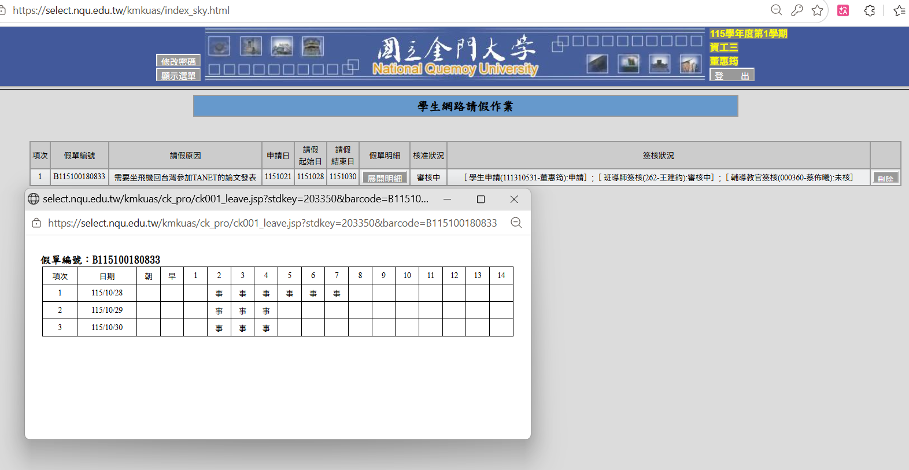

# 課程：現代軟體工程 -- 學生作業與專案

欄位 | 內容
-----|--------
學期 | 115 學年上學期
教師 | [陳鍾誠](https://www.nqu.edu.tw/educsie/index.php?act=blog&code=list&ids=4)
學校 | [金門大學資訊工程系](https://www.nqu.edu.tw/educsie/index.php)
學生 | 董惠筠
學號 | 111310531

## 二、作業列表（期中以前）

### 每週檢驗表格

第幾週| Github 對應標題名稱 |習題內容 | 有上課且準時繳交 | 檔案 / 連結 | 是否使用 AI 與連結
|------|------|----------|----------|--------------|--------------|
|1| 習題1  |crul| 是 |https://github.com/Dong-HuiYun/_se/tree/main/%E7%BF%92%E9%A1%8C1              |[使用 Claude](https://claude.ai/share/2ab99421-da4a-4f1b-b946-40a2a2e1bf19)|
|2| 習題2  |校務系統| 是 |https://github.com/Dong-HuiYun/_se/tree/main/%E7%BF%92%E9%A1%8C2              |[使用 Claude](https://claude.ai/share/1e92bb33-1b99-4636-adad-7b94d04dd09d)|
|3| 習題3  |PDF 工具| 是 |https://github.com/Dong-HuiYun/_se/tree/main/%E7%BF%92%E9%A1%8C3              |[使用 Claude](https://claude.ai/share/85f93029-7eab-45f3-b609-85326b24ffa4)|
|4| 習題4  |認識 Git|  是          |https://github.com/Dong-HuiYun/_se/tree/main/%E7%BF%92%E9%A1%8C4              |否|
|6| Week6  |Docker|  是          |https://github.com/Dong-HuiYun/_se/tree/main/Week6              |Docker 的使用是自己寫的，程式碼 [使用 Claude](https://claude.ai/share/b1ac6e10-e84d-4611-b9d8-d54244716ad5)|
|7| Week7  |測試網站|  是          |https://github.com/Dong-HuiYun/_se/tree/main/Week6              |[使用 Claude](https://claude.ai/share/d44d4889-6dd4-4d74-b9b1-803e9bf1e9f7)測試習題2的校務系統，並[使用 Claude](https://claude.ai/share/9d7076fa-04ea-4035-9d4e-6a4bcdb59fcb)測試以前寫的旅游網頁|
|8| Week8  |talk-to-db|  請假但有準時繳交（下圖是請假證明）          |https://github.com/Dong-HuiYun/_se/tree/main/Week8              |[使用 Google AI Studio](https://aistudio.google.com/app/prompts?state=%7B%22ids%22:%5B%221ix9DZleeecdbmqaORPVQxw27tx3J9KEA%22%5D,%22action%22:%22open%22,%22userId%22:%22104108532823114063447%22,%22resourceKeys%22:%7B%7D%7D&usp=sharing)|
|9|Week9|Cloudflare|是|https://github.com/Dong-HuiYun/_se/tree/main/Week9|[使用 Claude](https://claude.ai/share/787dc2a7-188f-4496-9b20-54aed3a5341e)

### 請假證明

第八週：已經提前請假，但班導尚未核准，後續會附上核准圖

---

## 三、各作業說明

### 習題1 ：請做一個類似 curl 的專案程式 (可用 AI, opencode + big pickle)

- **目標**：做一個 curl 程式，提供與 curl 相近的常用介面（method、header、body、輸出、重新導向、認證、代理、壓縮、計時），用 Python 標準函式庫就能執行，不依賴第三方套件。專案也能作為 HTTP 的測試工具。

- **程式碼/檔案路徑**：[習題1](https://github.com/Dong-HuiYun/_se/tree/main/%E7%BF%92%E9%A1%8C1)

- **成果説明**：[成果説明](https://github.com/Dong-HuiYun/_se/blob/main/%E7%BF%92%E9%A1%8C1/README.md)

### 習題 2 : 請做一個類似金門大學校務系統的專案程式 (可用 AI, opencode + big pickle)

- **目標**：實作一個類似金門大學校務系統的網頁，具備校務系統應具備的功能，如：選課、停修、請假、成績查詢之類的相關事宜。並需要確保該系統具備一定的安全性，如：初次登陸建議重設密碼、管理者無法看到學生的密碼，確保個資不被泄露。

- **程式碼/檔案路徑**：[習題2](https://github.com/Dong-HuiYun/_se/tree/main/%E7%BF%92%E9%A1%8C2)

- **成果説明**：[成果説明](https://github.com/Dong-HuiYun/_se/blob/main/%E7%BF%92%E9%A1%8C2/README.md)

### 習題 3 : 請想出一個有價值的專案程式，並實作出來 (可用 AI, opencode + big pickle, muse spark 1.3)

- **目標**：實作一個有商業價值或是使用價值的專案程式。因為在填寫資料、寫論文的時候，常常需要對 pdf 進行修改，需要在瀏覽器搜尋如：pdf 合併、pdf 刪除頁數等，資料上傳到雲端缺乏安全性，因此我實作了一個 pdf 操作工具，包含多種可用功能，並可在後續進行擴充。

- **程式碼/檔案路徑**：[習題3](https://github.com/Dong-HuiYun/_se/tree/main/%E7%BF%92%E9%A1%8C3)

- **成果説明**：[成果説明](https://github.com/Dong-HuiYun/_se/blob/main/%E7%BF%92%E9%A1%8C2/README.md)

### 第四週： git flow , github flow 的用法

- **目標**：熟悉 Github 的分支、合併、fork、pull request 流程及做法。

- **程式碼/檔案路徑**：[第四週](https://github.com/Dong-HuiYun/_se/tree/main/%E7%BF%92%E9%A1%8C4)

- **成果説明**：[成果説明](https://github.com/Dong-HuiYun/_se/blob/main/%E7%BF%92%E9%A1%8C4/README.md)

### 第六週： Docker 使用

- **目標**：學會使用 Docker，包含：理解 Dokcer 的基本操作、使用 Linux 系統下載 Docker 鏡像檔、脚本達到容器自動化部署、認識 Docker Desktop、實作簡單專案。最後實作微服務的 Docker 系統，包含 Dockerfile 和 docker-compose.yml，最後由 Web 介面進行展示。

- **程式碼/檔案路徑**：[第六週](https://github.com/Dong-HuiYun/_se/tree/main/Week6)

- **成果説明**：[Docker 用法](https://github.com/Dong-HuiYun/_se/blob/main/Week6/Docker%E4%BD%BF%E7%94%A8/README.md)、[微服務 Docker 成果説明](https://github.com/Dong-HuiYun/_se/blob/main/Week6/README.md)

### 第七週： 寫一個網站應用，要做三種測試

- **目標**：對第二週寫的金門大學校務系統，以及以前寫的旅游網頁進行三種測試：單元測試（Server）、系統測試（Web api）、e2e測試 (無頭瀏覽器，playwright)。

- **程式碼/檔案路徑**：[第七週 - 校務系統](https://github.com/Dong-HuiYun/_se/tree/main/Week7/%E6%A0%A1%E5%8B%99%E7%B3%BB%E7%B5%B1)、[第七週 - 臺北旅館預訂網頁](https://github.com/Dong-HuiYun/_se/tree/main/Week7/%E8%87%BA%E5%8C%97%E6%97%85%E9%A4%A8%E9%A0%90%E8%A8%82%E7%B6%B2%E9%A0%81)

- **成果説明**：[成果説明](https://github.com/Dong-HuiYun/_se/blob/main/Week6/README.md)、[校務系統網頁説明](https://github.com/Dong-HuiYun/_se/blob/main/Week7/%E6%A0%A1%E5%8B%99%E7%B3%BB%E7%B5%B1/README.md)、[臺北旅館預訂網頁説明](https://github.com/Dong-HuiYun/_se/blob/main/Week7/%E8%87%BA%E5%8C%97%E6%97%85%E9%A4%A8%E9%A0%90%E8%A8%82%E7%B6%B2%E9%A0%81/README.md)

### 第八週：回到習題 3，請想出一個有價值的專案程式，並實作出來

- **目標**：習題 3 已實作一款 pdf 工具，因此本次希望再實作一個商業數據查詢代理的專案。專案為自然語言數據問答代理，讓非技術背景的主管只需用通俗中文或英文提問，系統即可自動完成端到端分析，節省請專業資料分析師所花費的成本。資安方面，支援本地部署模型，避免資料外洩。

- **程式碼/檔案路徑**：[第八週](https://github.com/Dong-HuiYun/_se/tree/main/Week8)

- **成果説明**：[成果説明](https://github.com/Dong-HuiYun/_se/blob/main/Week8/README.md)

### 第九週： 請寫一個網站應用架到 cloudflare 上

- **目標**：學會如何在 Cloudflare 連接 Github 並將網站架設到自己的 Domain Name 上。

- **網站網址**：[第九週](https://se.donghuiyun446.workers.dev/)

- **成果説明**：[成果説明](https://github.com/Dong-HuiYun/_se/blob/main/Week9/README.md)