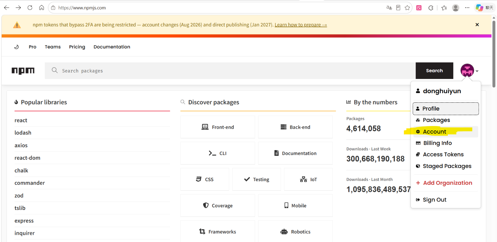
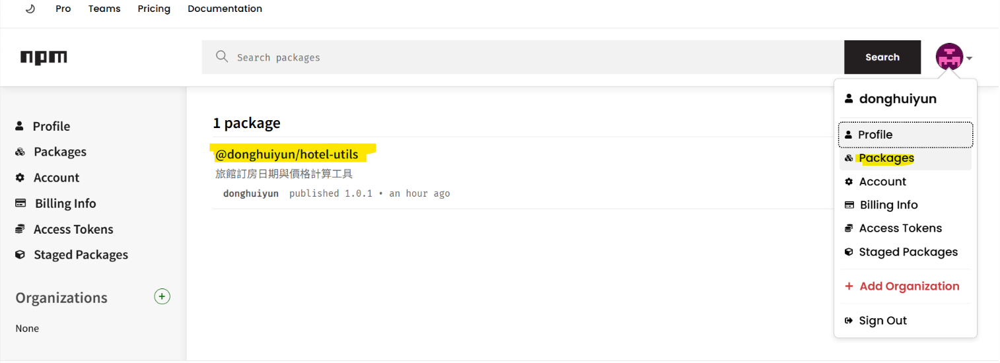
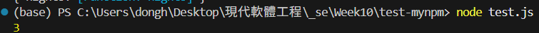
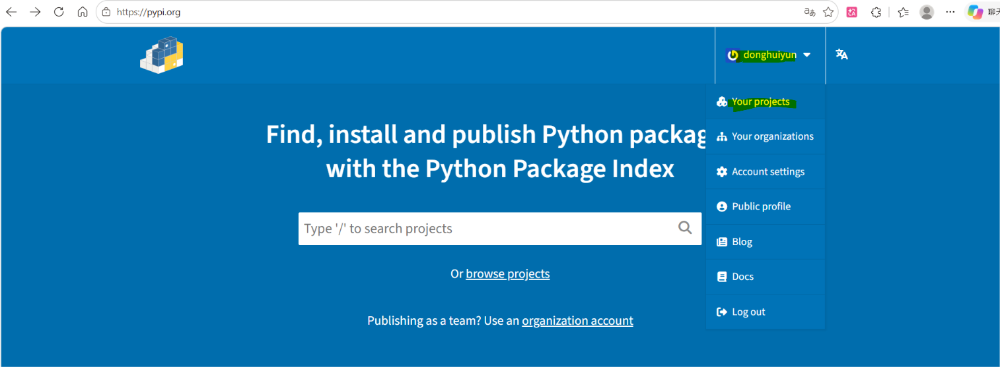
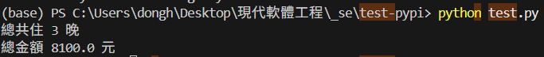

# 發佈空開套件庫

補充：domain name：https://www.cloudflare.com/domains/search

## npm 實作步驟

### 1. 準備帳號

到 [npmjs.com](https://www.npmjs.com/) 註冊，並啟用雙重驗證(2FA)

#### 雙重認證啟用位置

登錄後來，點擊右上角的頭像，選擇 Account



進入後，下滑找到**Two-Factor Authentication**點擊後進行啟用

### 2. 建立套件資料夾

```bash

mkdir hotel-utils && cd hotel-utils
npm init -y

```

### 3. 編輯 package.json

套件名稱不能和別人重複。因此可以使用帳號/套件名稱來避免重名

files 欄位指定要發布的檔案，避免誤傳其他檔案

```bash

{
  "name": "@npm帳號/hotel-utils",
  "version": "1.0.0",
  "description": "旅館訂房日期與價格計算工具",
  "main": "index.js",
  "license": "MIT",
  "files": ["index.js", "README.md"]
}

```

### 4. 寫程式

```bash

function nights(checkIn, checkOut) {
  const ms = new Date(checkOut) - new Date(checkIn);
  return Math.round(ms / 86400000);
}
module.exports = { nights };

```

### 5. 登錄與發佈

```bash

npm login
npm publish --access public

```

### 6. 驗證

```bash

npm view @npm帳號/hotel-utils

```

在 npm 界面 中，右鍵右上角的頭像，點選 Packages，即可看到新增的套件




[npm 套件網址](https://www.npmjs.com/package/@donghuiyun/hotel-utils/v/1.0.0)

### 7. 在其他資料夾進行測試

```bash

cd ..
mkdir test-hotel
cd test-hotel
npm init -y
npm install @donghuiyun/hotel-utils
node -e "console.log(require('@donghuiyun/hotel-utils'))"

```

引用測試

```

node test.js

```



## PyPI 實作步驟

### 1. 準備帳號

到 [pypi.org](https://pypi.org/) 註冊帳號、驗證 Email，並啟用雙重驗證（2FA）與產生 API Token。

#### 雙重驗證與 API Token 啟用位置

登入後，點擊右上角頭像／使用者名稱，選擇 **Account settings**：

1. **啟用雙重驗證（2FA）**：下滑找到 **Two factor authentication**，綁定驗證器 App 後，保存並輸入其中一組 16 碼 **Recovery code（備用恢復碼）** 完成驗證。
2. **建立 API Token**：再往下滑找到 **API tokens** → 點擊 **Add API token**，首次發佈新套件時 **Scope** 選擇 **`Entire account (all projects)`**，建立後複製該串 `pypi-` 開頭的 Token 保存（僅會顯示這一次）。

### 2. 建立套件資料夾與安裝打包工具

```bash

mkdir hotel-utils
cd hotel-utils
mkdir 帳號_hotel_utils
pip install build twine

```

*(註：PyPI 模組資料夾名稱需使用底線 `_`，不可使用減號 `-`)*

### 3. 編輯 `pyproject.toml`

PyPI 沒有像 npm 的 `@帳號/套件名` 命名空間，因此可在名稱前加上自己的帳號前綴（如 `帳號-hotel-utils`）來避免重名。

`[tool.hatch.build.targets.wheel]` 的 `packages` 欄位用來指定要打包進套件的資料夾，避免誤傳其他檔案或打包出空殼。

```toml
[build-system]
requires = ["hatchling"]
build-backend = "hatchling.build"

[project]
name = "donghuiyun-hotel-utils"
version = "1.0.0"
description = "旅館訂房日期與價格計算工具"
readme = "README.md"
requires-python = ">=3.9"
license = "MIT"
authors = [
  { name = "你的名字" }
]
dependencies = []

[tool.hatch.build.targets.wheel]
packages = ["帳號_hotel_utils"]
```

### 4. 寫程式與 `README.md`

在 `donghuiyun_hotel_utils/__init__.py` 寫入程式碼：

```python
from __future__ import annotations
from datetime import date, datetime

__all__ = ["nights", "total_price"]


def _parse_date(value: str | date | datetime) -> date:
    if isinstance(value, datetime):
        return value.date()
    if isinstance(value, date):
        return value
    return date.fromisoformat(value)


def nights(check_in: str | date | datetime, check_out: str | date | datetime) -> int:
    start = _parse_date(check_in)
    end = _parse_date(check_out)
    if end < start:
        raise ValueError("退房日期不能早於入住日期")
    return (end - start).days


def total_price(
    check_in: str | date | datetime,
    check_out: str | date | datetime,
    price_per_night: float,
    discount: float = 1.0,
) -> float:
    if price_per_night < 0:
        raise ValueError("房價不能小於 0")
    if not (0 < discount <= 1):
        raise ValueError("折扣倍率必須介於 0 到 1 之間")
    return round(nights(check_in, check_out) * price_per_night * discount, 2)
```

同時在根目錄建立 `README.md`（因為 `pyproject.toml` 有設定 `readme = "README.md"`，缺少此檔打包會失敗）：

```markdown

# donghuiyun-hotel-utils

旅館訂房日期與價格計算工具。

## 安裝

pip install donghuiyun-hotel-utils

```

### 5. 打包與發佈

```bash

python -m build
python -m twine check dist/*
python -m twine upload dist/*

```

執行 `twine upload` 後，出現 `Enter your API token:` 時貼上步驟 1 產生的 `pypi-...` Token（螢幕不會顯示輸入字元，貼上一次直接按 Enter 即可）。

### 6. 驗證

發佈後，在 phpi 界面 中，右鍵右上角的帳號名稱，選擇 **Your projects** 即可查看新建的套件




[pypi 套件網址](https://pypi.org/project/donghuiyun-hotel-utils/)

切換到其他資料夾測試安裝與執行：

```bash

pip install --upgrade donghuiyun-hotel-utils
pip show -f donghuiyun-hotel-utils
python -c "from donghuiyun_hotel_utils import nights, total_price; print(nights('2026-11-13', '2026-11-16')); print(total_price('2026-11-13', '2026-11-16', 3000, 0.9))"

```

