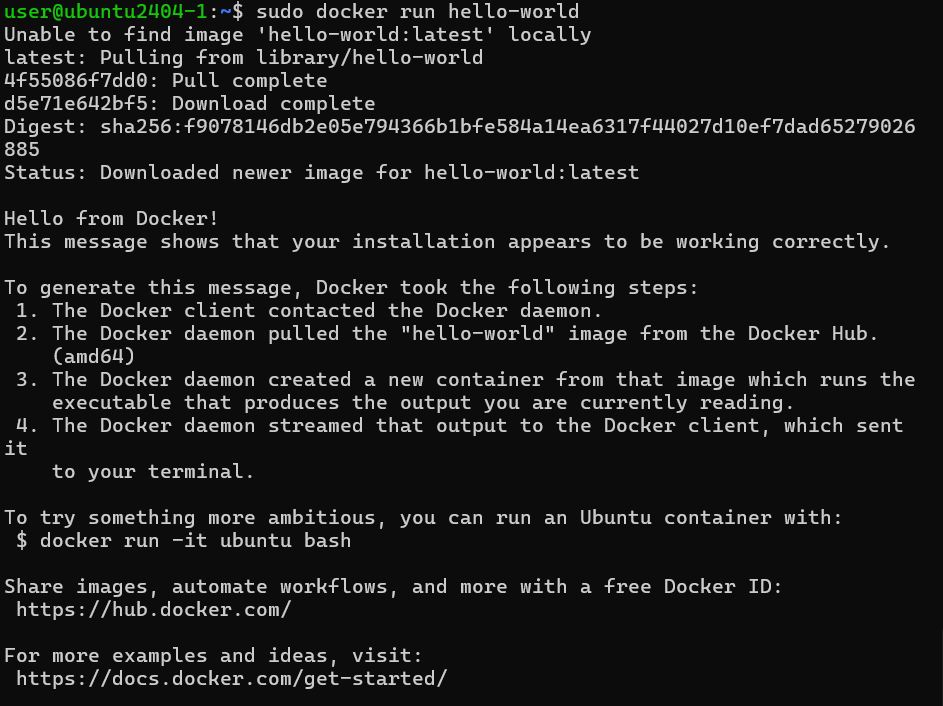
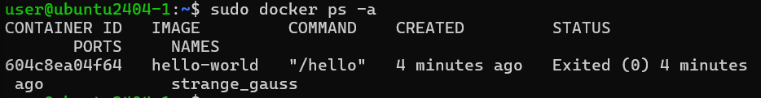
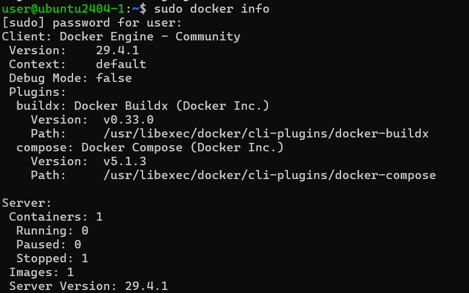
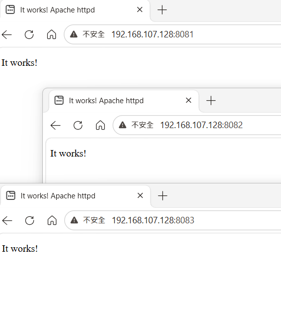
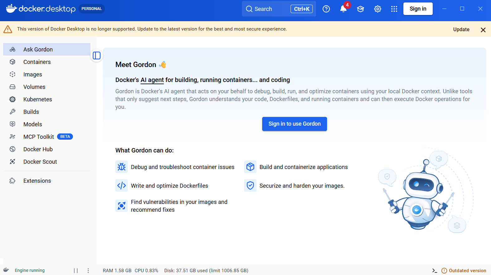
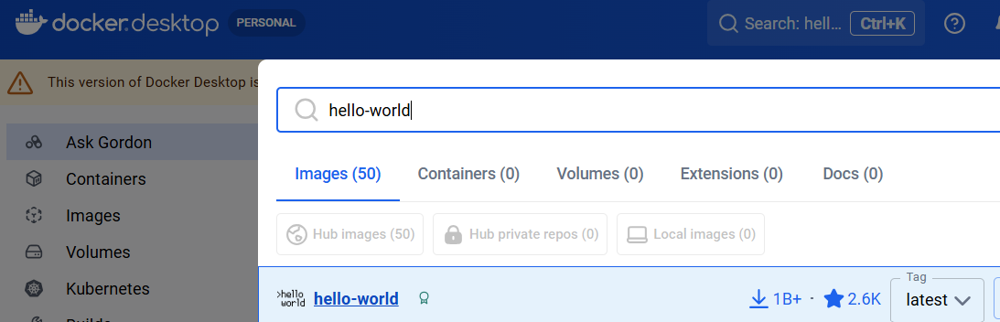
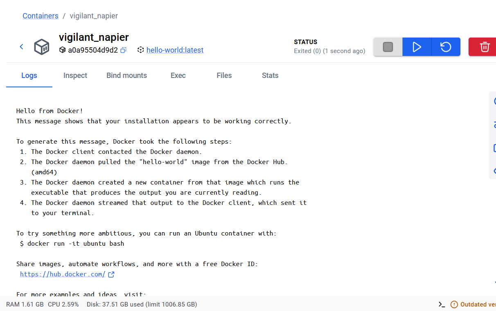
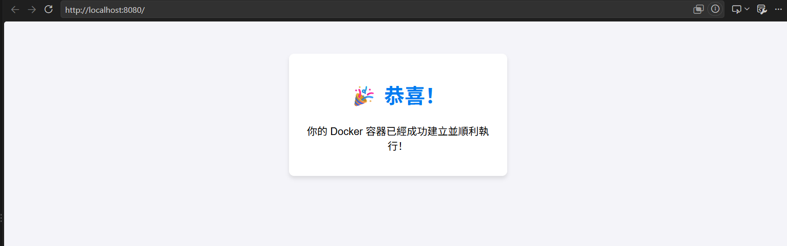

# Docker 使用

Docker：一個符合linux環境的東西，把系統放在資料夾一樣，可以在同一台機器下放下多台docker，把服務細分規模化，能夠快速開發應用程式上線，可與作業系統進行隔離

Kubernetes（k8s）：讓docker中的服務可以隨時打開關閉

---

## 一、使用官方鏡像進行測試（本次使用 Linux 系統）

使用官方的鏡像檔 [hello-world](https://hub.docker.com/_/hello-world/) 進行測試與診斷


### 下載與運行

- `sudo docker run hello-world`：到雲端的鏡像倉庫把hello-world的鏡像拉到本地端，並把這個容器給跑起來

拉取鏡像由三個步驟所構成：docker image website/who/image name:tag，若不寫tag，則預設最新版（:latest）。若使用官方預設的docker，則docker image website和who可以省略

- `sudo docker pull httpd:latest`:從 Docker Hub 官方倉庫下載最新版本（latest）的 Apache Web 伺服器鏡像（Image）到電腦中

### Unable to find image

Unable to find image 'hello-world:latest' locally：第一次使用時，在本地端無法找到 `hello-world` 的鏡像，因此後續會去官方網頁中抓取，並在本地形成一個新的鏡像



### 容器狀態

- 若容器沒有做事情，則會結束（狀態為 Exited）

- `sudo docker images`：查看下載到本地的images

- `sudo docker ps -a`：顯示容器ID、名稱、狀態等資訊

    - `ps`：針對還在運作的容器進行顯示

    - `-a`：加上已經離開的容器一起進行顯示

    

    - 若容器較少，只需要寫出容器的前幾個id（例如前三個字：604），可與其他容器區分就足夠了。若要操控容器，可以選擇容器的id或容器的名稱。

    - `sudo docker info`：顯示 Docker 系統整體資訊與運行狀態

    

### 背景運行

`sudo docker run -d --name web1 -p 8080:80 httpd:latest`：讓容器在背景進行執行，容器名稱設置成web1

- 8080：虛擬機的port

- 80：容器的port

### 刪除容器

- `sudo docker rm 604`：刪掉容器id為604的容器

- `sudo docker rm hello-world`：刪掉容器名稱為hello-world的容器

- `sudo docker rm -f container_id`：强制刪除一個還在執行的docker

## 二、使用脚本達到容器的自動化佈署

附件中的 `test-httpd-docker.sh` 檔案為容器的脚本，作用在以最高權限（root）自動批次啟動 3 個 Apache Web 伺服器容器。

### 執行執行檔

`chmod +x ./test-httpd-docker.sh`：賦予當前目錄下的 `test-httpd-docker.sh` 腳本檔案的執行權限。

### 瀏覽器測試容器是否自動部署 Aapche

網址填入本機 ip，以及埠號 8081、8082、8083，瀏覽器即可開啟：`http://<本機 ip>:埠號`



### 運行完刪除容器

`docker rm -f $(docker ps -a -q)`

## 三、認識 Docker Desktop



### Containers（容器）

- 功能：檢視與管理所有正在運行或已停止的容器。

- 作用：可以啟動、停止、重啟、刪除容器，或查看容器的運行日誌（Logs）與進入 Terminal 視窗。

### Images（鏡像）

- 功能：管理本地端的 Docker 鏡像（Images）。

- 作用：查看已下載或建置好的 Image 清單、大小、標籤（Tag），並可以直接點擊 Run 啟動容器。

### Kubernetes（k8s）

- 功能：本地單節點 Kubernetes (K8s) 環境管理。

- 作用：若在設定中啟動了 K8s，可在這裡查看本地叢集（Cluster）的執行狀態與相關物件。

### Builds（建置歷史）

- 功能：檢視 docker build 的紀錄與快取（Cache）狀態。

- 作用：幫助分析鏡像建置的過程與耗時，協助優化 Dockerfile。

### 測試運行



容器下載完畢，按下 RUN 運行，Logs 畫面印出了訊息：顯示了 “Hello from Docker!” 即代表運行成功



## 四、實作簡單專案檔案結構

* `Dockerfile`：定義容器建置步驟的文字檔。
* `app.py`：一個簡單的 Python Web 伺服器程式碼。
* `README.md`：本教學說明文件。

---

### 步驟

#### 步驟 1：建立 Docker 鏡像 (Build Image)

開啟終端機（Terminal 或 PowerShell），切換至專案根目錄，執行以下指令建立 Image：

```bash
docker build -t my-docker-app .
```

> **參數說明：**
> * `-t my-docker-app`：指定 Image 的名稱標籤為 `my-docker-app`。
> * `.`：代表使用「目前目錄」下的 Dockerfile。

---

#### 步驟 2：啟動 Docker 容器 (Run Container)

鏡像建立完成後，輸入以下指令啟動容器：

```bash
docker run -d -p 8080:8080 --name my-running-app my-docker-app
```

> **參數說明：**
> * `-d`：（Detached Mode）讓容器在背景執行。
> * `-p 8080:8080`：將電腦本地（Host）的 8080 連接埠對映到容器內部的 8080 連接埠。
> * `--name my-running-app`：給執行中的容器設定一個自訂名稱。
> * `my-docker-app`：指定要使用的鏡像名稱。

---

#### 步驟 3：驗證成果

開啟瀏覽器並存取以下網址：
[http://localhost:8080](http://localhost:8080)

若看到 **「🎉 恭喜！你的 Docker 容器已經成功建立並順利執行！」** 的畫面，代表成功！



---

## 實用 Docker 管理指令

| 操作 | 指令 |
| --- | --- |
| **檢視執行中的容器** | `docker ps` |
| **檢視所有容器（包含已停止）** | `docker ps -a` |
| **查看容器即時 Log** | `docker logs -f my-running-app` |
| **停止容器** | `docker stop my-running-app` |
| **啟動已停止的容器** | `docker start my-running-app` |
| **刪除容器** | `docker rm -f my-running-app` |
| **檢視本地端所有 Image** | `docker images` |
| **刪除 Image** | `docker rmi my-docker-app` |

---

## 觀念總結

1. **Dockerfile**：寫下環境需求與指令的「藍圖」。
2. **Image（鏡像）**：將藍圖打包出來的「安裝檔/模板」。
3. **Container（容器）**：由 Image 啟動的「獨立執行環境/實際運作中的程式」。