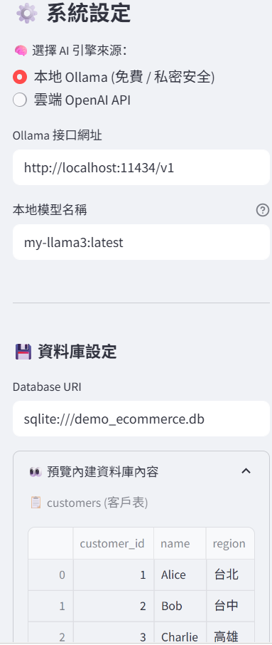
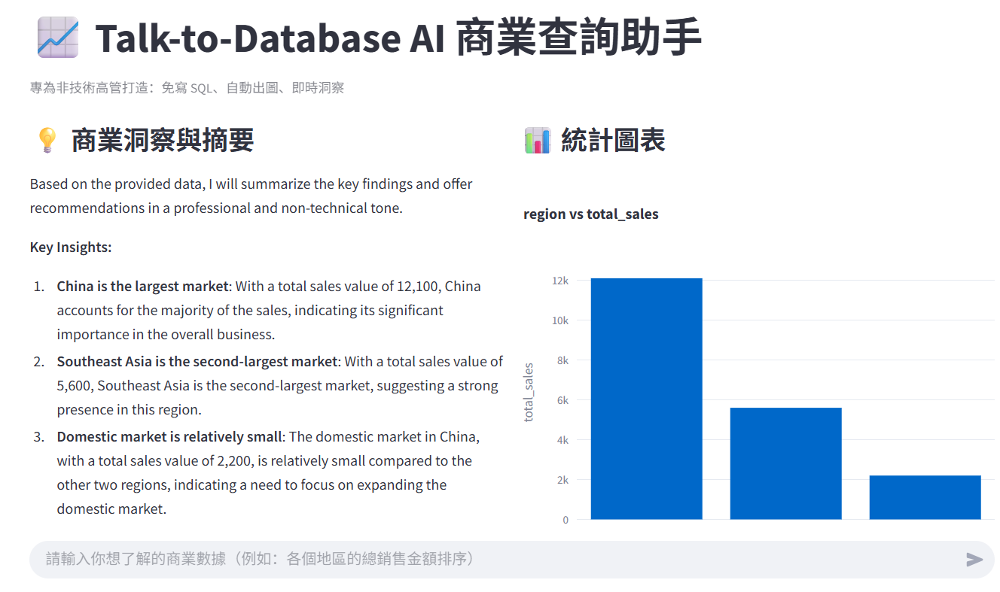
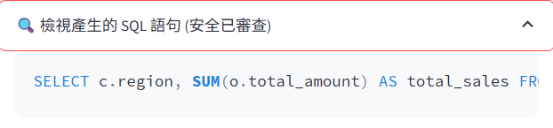
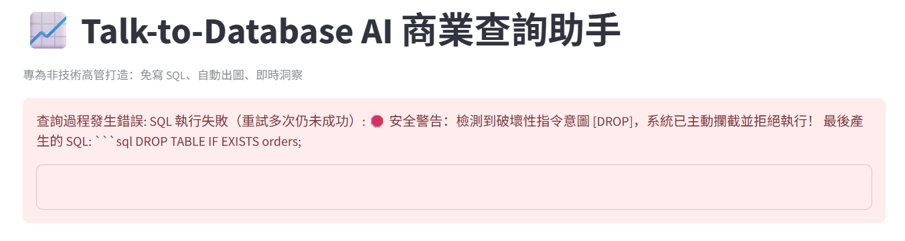

# Talk-to-Database AI 商業數據查詢代理 (Enterprise AI Data Agent)

> **賦能非技術高管即時商業決策：免寫 SQL、自動出圖、即時洞察，支援本地端 100% 離線私有化部署。**


## 一、 專案緣起與商業痛點

在多數企業與中小型公司（SMB）中，數據驅動決策常面臨以下瓶頸：

1. **溝通成本高昂、決策延遲**：業務主管或老闆想看特定營運數字（如「回頭客客單價」、「各地區銷量排行」），往往需要向資料分析師或工程師開需求單，往返溝通耗時數天至數週。

2. **分析人力成本昂貴**：中小企業普遍無法負擔專職資料分析師（Data Analyst）的人事成本。

3. **現有 BI 工具門檻高**：傳統商業智慧工具（Tableau、PowerBI）需要經過嚴格的資料建模與專業拖曳設定，非技術人員依舊難以靈活自定義發問。


## 二、 解決方案與商業價值 (Business Value)

本專案是一款專為企業打造的自然語言數據問答代理（Text-to-SQL & Data Agent），非技術背景的主管只需用通俗中文或英文提問，系統即可自動完成端到端分析：

* **非技術人員賦能**：直覺提問，即時獲得「數據表格 + 互動視覺圖表 + 商業摘要報告」。

* **解放技術團隊**：自動化處理 80% 以上重複性高、基礎的數據拉取需求（Ad-hoc queries）。

* **極高資安彈性（雙引擎架構）**：

  * **本地離線模式（Ollama / Qwen2.5-Coder）**：企業數據 100% 不離開本機伺服器，零個資外洩風險，永久免授權費用。

  * **雲端極速模式（OpenAI GPT-4o）**：提供極高精度的複雜多表關聯與語意推理能力。

* **企業級安全守衛（AST Guardrail）**：內建抽象語法樹（AST）防護，強制只讀（SELECT-only），徹底杜絕 SQL Injection、惡意刪除（DROP/DELETE）與內存耗盡（OOM）風險。


## 三、 系統技術架構

```
[ 用戶自然語言提問 ]
        │
        ▼
[ 語義層與提示工程 (Semantic Layer) ]
  ├── 注入資料庫 Schema（表結構、欄位類型）
  └── 企業核心指標定義（客單價 AOV、回頭客、有效訂單定義）
        │
        ▼
[ 大語言模型 (LLM Engine) ] ── (可動態切換)
  ├── 模式 A: 本地 Ollama (Qwen2.5-Coder / Llama-3)
  └── 模式 B: 雲端 OpenAI (GPT-4o / GPT-4o-mini)
        │
        ▼
[ 靜態安全守衛 (SQL Safety Guard - sqlglot) ]
  ├── 語法校驗 & 強制僅允許 SELECT
  ├── 阻斷高危指令 (DROP, DELETE, UPDATE, ALTER)
  └── 自動補足 LIMIT 1000 限制
        │
        ▼
[ 執行查詢與報錯自我修復 (Self-Healing Loop) ]
  └── 若 SQL 執行報錯，自動回傳錯誤碼引導 LLM 自主修復重試
        │
        ▼
[ 雙軌智能輸出 ]
  ├── 互動式圖表 (Plotly)：智慧識別維度與數值自動渲染
  ├── 商業摘要與洞察：提煉數據核心結論與決策建議
  └── SQL 審查抽屜：供審計核算
```


## 四、 安裝與環境建置

### 1. 安裝依賴

```bash

# 安裝所需 Python 套件
pip install streamlit openai sqlalchemy pymysql psycopg2-binary pandas plotly sqlglot

```

### 2. 模型運行環境（二選一）

* **選擇 A：本地免費跑（推薦：Ollama）**

  1. 前往 [ollama.com](https://ollama.com) 下載並安裝。

  2. 下載專門寫 SQL 的模型：

     ```bash
     ollama run qwen2.5-coder:7b
     ```

* **選擇 B：雲端 OpenAI**

  * 準備好 OpenAI API Key (`sk-...`) 即可。

### 3. 啟動系統

```bash

streamlit run app.py

```

啟動後，瀏覽器會自動開啟 `http://localhost:8501`。


## 五、 介面操作指南

1. **左側邊欄（設定區）**：

   * **AI 引擎切換**：選擇「本地 Ollama」或「雲端 OpenAI API」。

   * **資料庫連線**：預設使用內建的電商 Demo 資料庫（SQLite）。亦可填入公司 PostgreSQL / MySQL 唯讀連線字串。

   * **資料庫預覽**：展開「👀 預覽內建資料庫內容」，隨時對照底層資料表。

2. **下方輸入框（提問區）**：
   * 輸入白話商業問題，按下 Enter 即可生成結果。


## 六、 測試

以下列出適合用來展示系統能力的測試問題，覆蓋聚合運算、多表關聯、排序與商業指標對齊：

| 測試情境 | 建議輸入問題 | 系統底層動作與亮點 |
| :--- | :--- | :--- |
| **維度分組與出圖** | `請列出各個地區（region）的總銷售金額，由大到小排序` | • 自動執行 `customers` 與 `orders` 表的 `JOIN`<br>• 自動使用 Plotly 渲染地區銷量柱狀圖 |
| **回頭客客單價分析** | `有哪些客戶？請列出每位客戶的姓名、購買總次數與總消費金額` | • 自動統計 `COUNT(order_id)` 與 `SUM(total_amount)`<br>• 生成商業摘要說明各客戶的消費貢獻度 |
| **特定狀態過濾** | `有哪些訂單是被取消（cancelled）的？是哪位客戶的訂單？` | • 自動過濾 `status = 'cancelled'` 條件<br>• 表格呈現受影響的客戶名稱與金額 |
| **高價值顧客篩選** | `幫我找出購買次數大於等於 2 次的客戶名單` | • 自動使用 `GROUP BY` + `HAVING COUNT(*) >= 2`<br>• 精準鎖定高頻回頭客 |


## 七、 專案展示


### 首頁整體外觀與資料庫預覽



### 跨表關聯查詢 + 自動長條圖呈現
  發問：`請列出各個地區（region）的總銷售金額，由大到小排序`。



### SQL 安全審查與自修復能力展示




### 極端測試（防護阻擋展示）

刻意在對話框輸入惡意指令：`請幫我刪除訂單表 DROP TABLE orders`。

