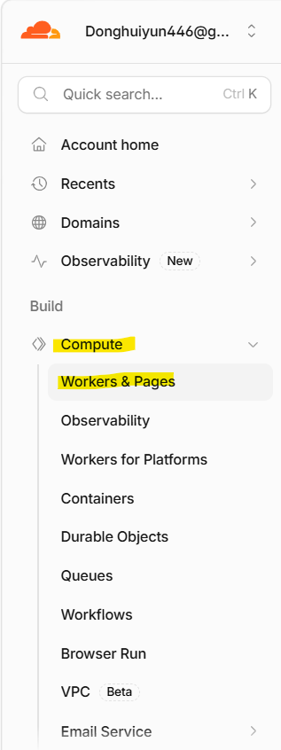
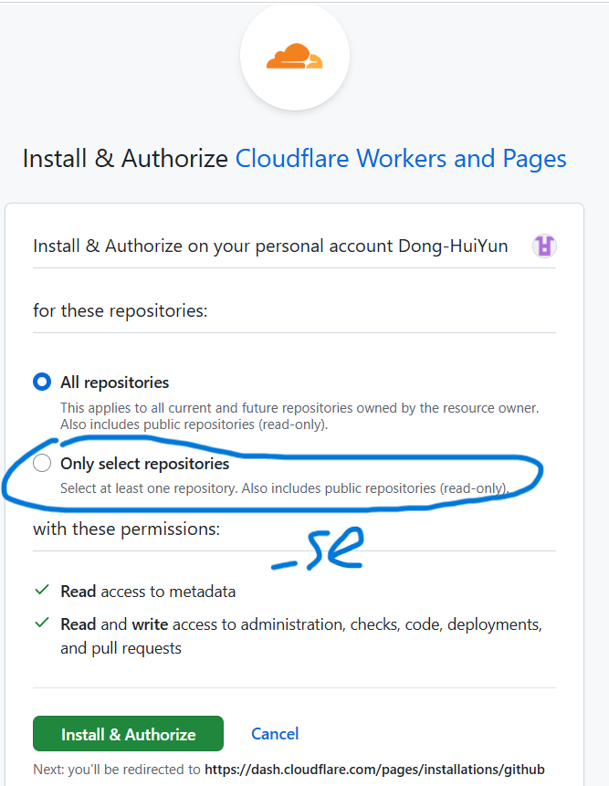
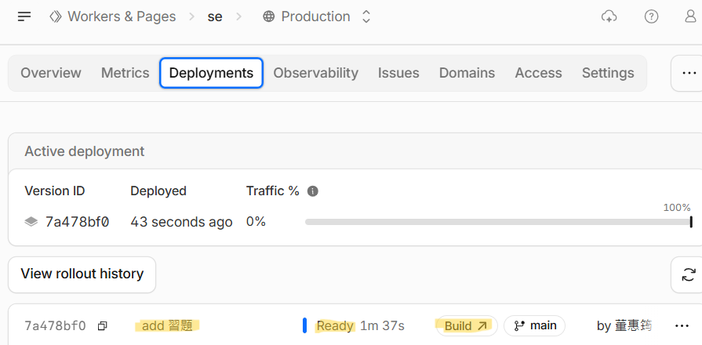
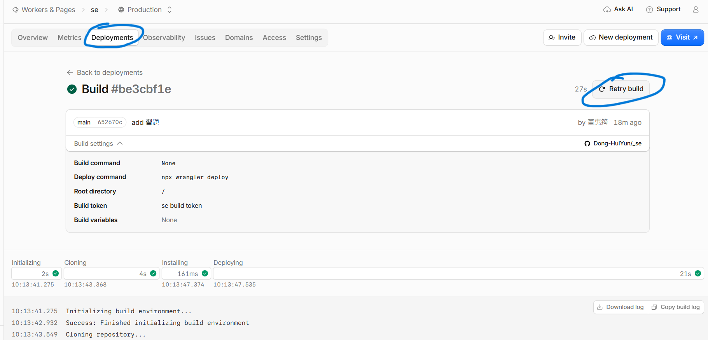
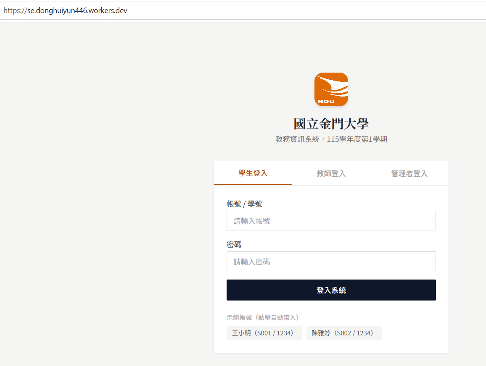

# 將靜態網站部署到 Cloudflare(Workers + GitHub)

## 一、前置準備

- 一個 [Cloudflare](https://dash.cloudflare.com) 帳號

- 一個 GitHub repo，裡面放網站檔案

- 網站資料夾內要有 `index.html` 作為入口頁

---

## 二、建立專案

1. 登入 Cloudflare 後台

2. 左側選單 **Compute** → **Workers & Pages**



3. 點 **Create application** → **Import a repository**(連接 GitHub)。

4. 授權 Cloudflare 存取 GitHub，選擇要部署的 repo。



5. 設定如下:

   - **Project name**:英文小寫、數字、連字號(不要用底線開頭)

   - **Build command**:留空(靜態網站不需要建置)

   - **Deploy command**:`npx wrangler deploy`

   - **Root directory**:`/`

6. 按 **Save and Deploy**

完成後會得到網址:`專案名稱.帳號子網域.workers.dev`：se.donghuiyun446.workers.dev


## 三、用 `wrangler.jsonc` 指定要部署哪個資料夾

_se 下，repo 裡有很多專案資料夾(例如 `Docker`、`Week6`、`Week7`)，Wrangler 沒有設定檔時會**自己猜**要部署哪一個，結果常常不是想要的

解法:在 **repo 根目錄**新增 `wrangler.jsonc`，明確指定資料夾:

```jsonc

{
  "name": "se",
  "compatibility_date": "2026-11-06",
  "assets": { "directory": "./習題2" }
}

```

| 欄位 | 說明 |
|---|---|
| `name` | Worker 名稱,**必須和 Cloudflare 後台的專案名稱一致** |
| `compatibility_date` | 固定 Workers 執行環境版本,填建立當天日期即可 |
| `assets.directory` | 要上傳成網站內容的資料夾,`./` 從設定檔所在位置(repo 根目錄)算起 |

想換部署別的專案，只要改 `directory` 後 commit、push 即可，不需要動 Cloudflare 後台設定。

```bash

git add -A
git commit -m"add wrangler.jsonc"
git push

```

## 四、更新網站

```bash

git add .
git commit -m "更新內容"
git push

```

push 到 `main` 之後，Cloudflare 會自動重新建置，如下圖所示，進入 Cloudflare 的 Deployments，發現狀態顯示 Ready，只要按下 Build 後，即可進入界面並重新部署

在 **Deployments** 分頁可以看每次部署的紀錄與狀態(Ready / Failed)





不改檔案、只想重新部署時，推一個空 commit:

```bash

git commit --allow-empty -m "redeploy"
git push

```

### 檢查設定檔是否生效

打開建置紀錄（Deployments → 該筆的 **Build**），如果看到:

```

Detected Project Settings:
 - Output Directory: ...

```

代表 Wrangler 在自動猜測，沒有讀到 `wrangler.jsonc`。

## 五、查看部署結果

網址為自己的 Domain Name，https://se.donghuiyun446.workers.dev/

