# 國立金門大學 教務資訊系統

## 一、簡介

模擬國立金門大學教務資訊系統，提供**學生、教師、管理者**三種角色的完整操作介面，涵蓋選課、成績、課表、公告、學籍異動申請與後台管理等校務功能。

### 特色

- **三種角色登入**：學生 / 教師 / 管理者，各自擁有獨立功能選單與權限
- **完整選課流程**：加退選、衝堂檢查、額滿判斷、學分統計
- **成績管理**：教師登錄成績、學生查詢成績、GPA 與畢業學分計算
- **學籍異動申請**：休學 / 復學 / 停修，含送出、審核、核准 / 駁回完整流程
- **公告系統**：依角色提供不同權限（管理者可編輯刪除、教師可發布、學生唯讀）
- **課表視覺化**：以表格呈現每週節次與課程
- **資料持久化**：重新整理不遺失，並可一鍵重設為示範資料


## 二、系統架構

### 技術棧

| 項目 | 使用技術 |
|------|----------|
| 前端框架 | React 18（UMD 版本） |
| JSX 編譯 | Babel Standalone（瀏覽器端即時編譯） |
| 樣式 | Tailwind CSS（CDN） |
| 圖示 | Lucide Icons（UMD） |
| 字型 | Noto Serif TC / Noto Sans TC |
| 資料儲存 | localStorage |

### 檔案結構

```
.
├── index.html              # 入口，載入所有模組並掛載 React App
├── README.md
│
├── data/                   # 資料層
│   ├── constants.js        # 共用常數、GPA 計算、ID 產生器
│   ├── students.js         # 學生種子資料
│   ├── teachers.js         # 教師種子資料
│   ├── admins.js           # 管理者種子資料
│   ├── courses.js          # 課程種子資料
│   ├── enrollments.js      # 選課紀錄種子資料
│   ├── grades.js           # 成績種子資料
│   ├── announcements.js    # 公告種子資料
│   ├── applications.js     # 申請案件種子資料
│   └── storage.js          # localStorage 讀寫與重設控制器
│
├── icons.js                # Lucide 圖示封裝 + 共用 UI 元件
│                           #（PageHeader / StatCard / DataTable /
│                           #  FormModal / ConfirmDialog / Toast / 等）
├── auth.js                 # 登入頁面（LoginScreen）
├── announcements.js        # 校園公告頁（三角色共用）
├── applications.js         # 學籍異動申請 + 管理者審核頁
├── student.js              # 學生端：儀表板、課表、選課、成績、歷年成績
├── teacher.js              # 教師端：儀表板、任教課程、成績登錄
├── admin.js                # 管理者端：總覽、學生/教師/課程管理
└── images/
    └── nqu_logo.png        # 校徽圖片
```

### 資料流

```
seedData() ──► localStorage ──► EAS_STORAGE.load() ──► React state (data)
                                                              │
                            persist(newData) ◄────────────────┤
                                  │                           │
                                  ▼                           ▼
                          EAS_STORAGE.save()          各頁面依角色渲染
```

`index.html` 中的 `App` 元件持有全域 `data` state，任何頁面透過 `persist(newData)` 更新資料並同步寫回 localStorage，確保資料一致性。

---

## 三、運作方法

### 環境需求

- 任一現代瀏覽器（Chrome / Edge / Firefox / Safari）

- 需要能連線至 CDN（React、Tailwind、Babel、Lucide 皆由 CDN 載入）

- Python 3（僅用於啟動本機靜態伺服器，可替換為其他工具）

### 啟動步驟

1. 進入專案目錄

2. 啟動本機靜態伺服器：

```bash
python -m http.server 3000
```

3. 瀏覽器開啟：

```

http://localhost:3000

```

> **不可直接雙擊 `index.html`**（`file://` 協定）。因為專案使用 `<script type="text/babel" src="...">` 載入外部 JSX 模組，瀏覽器在 `file://` 下會因 CORS 限制而無法載入，必須透過 HTTP 伺服器。

### 示範帳號

| 角色 | 帳號 | 密碼 | 姓名 |
|------|------|------|------|
| 學生 | S001 | 1234 | 王小明 |
| 學生 | S002 | 1234 | 陳雅婷 |
| 教師 | T001 | 1234 | 林志明 |
| 管理者 | A001 | 1234 | 系統管理員 |

登入頁下方有「示範帳號」按鈕，點擊即可自動帶入帳密。


## 四、功能說明

### 學生端

| 頁面 | 功能 |
|------|------|
| 首頁總覽 | 本學期學分、累計 GPA、畢業學分達成度、最新公告 |
| 個人資料 | 學籍資料檢視、修改密碼 |
| 課表查詢 | 以星期 × 節次表格呈現本學期課表 |
| 加退選課 | 瀏覽可選課程、加選（含衝堂 / 額滿檢查）、退選 |
| 成績查詢 | 依學期查詢成績、等第、學期 GPA |
| 歷年成績總表 | 列出所有學期成績與各學期 / 累計 GPA |
| 學籍/課程異動申請 | 提出休學、復學、停修申請並追蹤審核狀態 |
| 校園公告 | 瀏覽公告（唯讀） |

**特別設計**：學生首次登入（或管理者重設密碼後）會彈出「是否修改密碼」提示，且管理者無法查看學生修改後的密碼。

### 教師端

| 頁面 | 功能 |
|------|------|
| 教師工作台 | 任教課程數、授課學生人次、總學分、最新公告 |
| 任教課程 | 列出本學期開設課程與選課人數 |
| 成績登錄 | 選擇課程後逐筆輸入學生分數，即時顯示等第，批次儲存 |
| 校園公告 | 可發布公告（但不能編輯 / 刪除他人公告） |
| 個人資料 | 人事資料檢視、修改密碼 |

### 管理者端

| 頁面 | 功能 |
|------|------|
| 系統總覽 | 學生 / 教師 / 開課 / 選課人次 / 待審案件統計，各系所開課分布圖 |
| 學生管理 | 新增 / 編輯 / 刪除學生（刪除連帶清除選課、成績、申請） |
| 教師管理 | 新增 / 編輯 / 刪除教師（有開課紀錄者不可刪除） |
| 課程管理 | 新增 / 編輯 / 刪除課程，含教室衝堂檢查 |
| 申請案件審核 | 依狀態分頁檢視，核准（自動套用學籍 / 選課異動）或駁回（填寫原因） |
| 公告管理 | 完整新增 / 編輯 / 刪除公告 |
| 個人資料 | 修改密碼 |

### 跨角色共用機制

- **Toast 通知**：操作成功 / 失敗即時提示，3 秒後自動消失

- **ConfirmDialog**：刪除等危險操作二次確認

- **FormModal**：統一的表單彈窗元件，支援文字、數字、下拉、多選節次、多行文字

- **密碼修改**：所有角色皆可在個人資料頁修改密碼，需驗證舊密碼


## 五、關鍵設計說明

1. **角色權限分離**：`App` 依 `currentUser.role` 組裝不同 `menu` 與 `content`，各頁面再透過 props（如 `canManage`、`canPost`）細控按鈕顯示。

2. **衝堂檢查**：加選時比對已選課程的 `day` 與 `periods`；課程管理則檢查同教室、同星期、節次重疊。

3. **成績計算**：`scoreToGrade()` 將 0–100 分轉為等第與積分，`computeGpa()` 以學分加權平均。

4. **申請核准連動**：核准休學 / 復學時更新學生 `status`；核准停修時移除對應選課紀錄。

5. **資料相容性**：`EAS_STORAGE.load()` 會補上舊存檔缺少的 `applications` 欄位，避免版本升級出錯。

6. **密碼隱私**：管理者編輯學生時密碼欄留空表示不變更，且無法查看原密碼；學生自行改密碼後 `passwordChanged` 設為 `true`，不再重複提示。


## 六、校務系統展示

1. **登錄頁**：三種角色登入介面，點擊示範帳號可快速帶入


2. **管理者系統總覽**：顯示五大統計指標與各系所開課分布

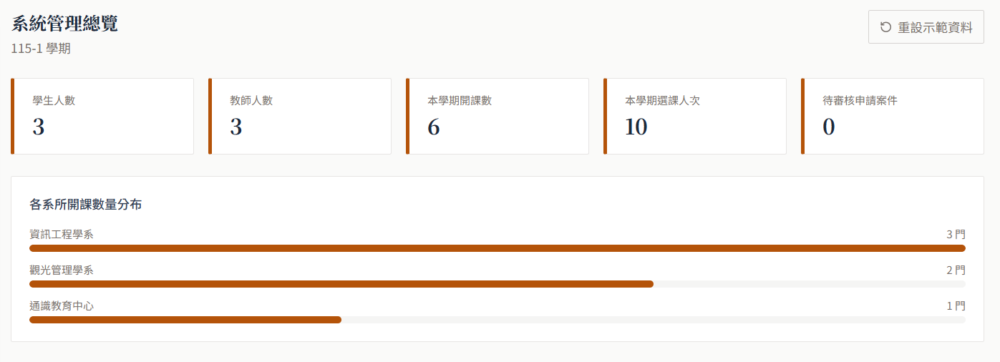


3. **學生加退選課**：在課程未滿額時可加選課程

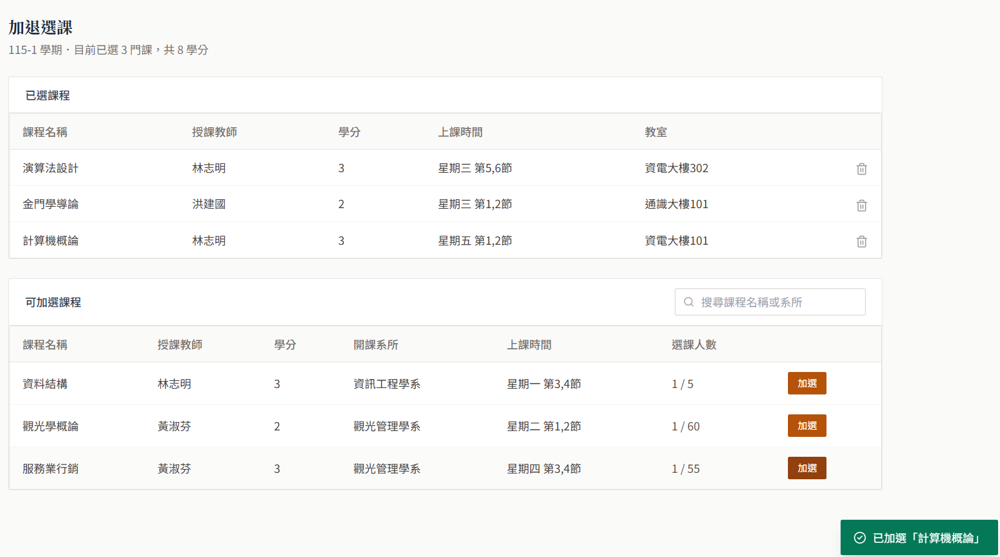


4. **教師成績登錄**：教師逐筆輸入分數，等第即時計算

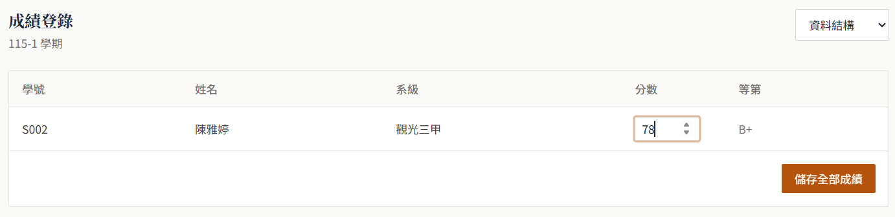

5. **申請案件審核**：管理者可依狀態分頁審核休學 / 復學 / 停修申請

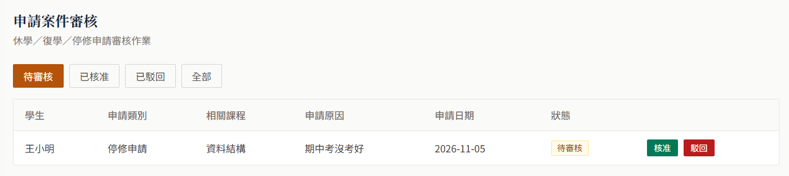

6. **學生首頁總覽**：學生首頁整合學分、GPA 與畢業進度

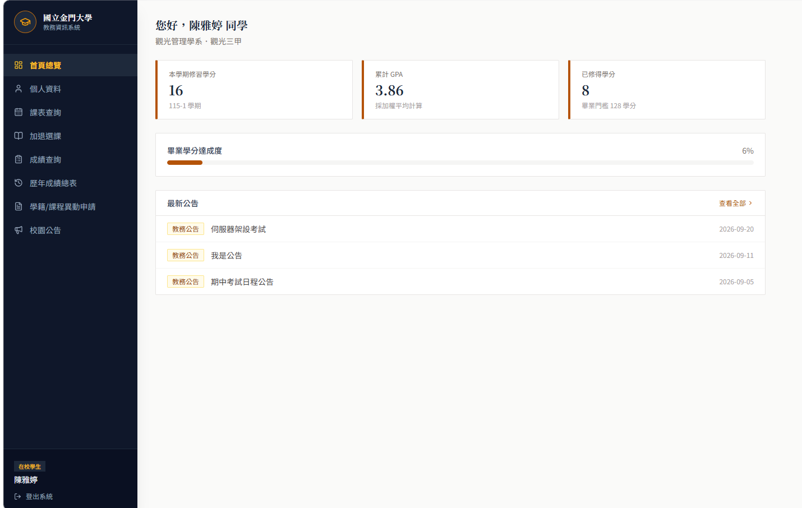


7. **課表查詢**：以表格視覺化呈現每週課表

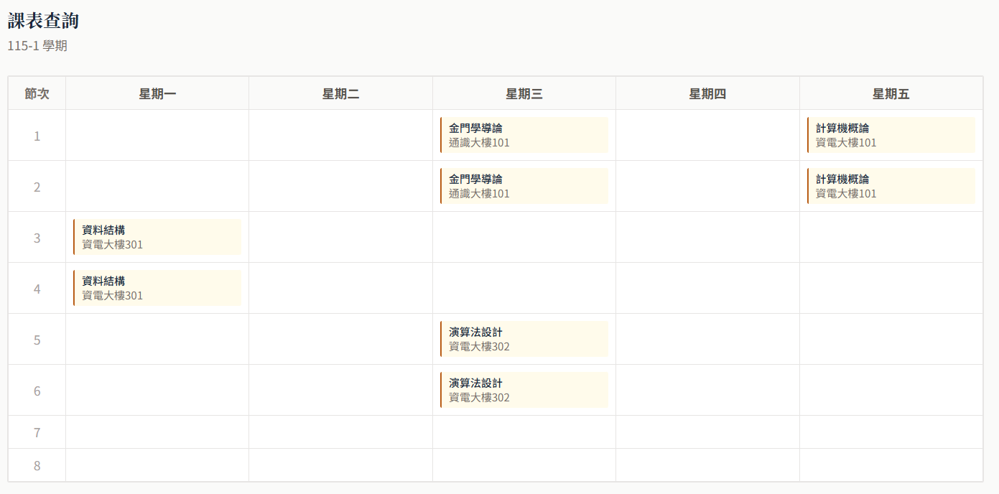

8. **歷年成績總表**：一次瀏覽所有學期成績與累計 GPA

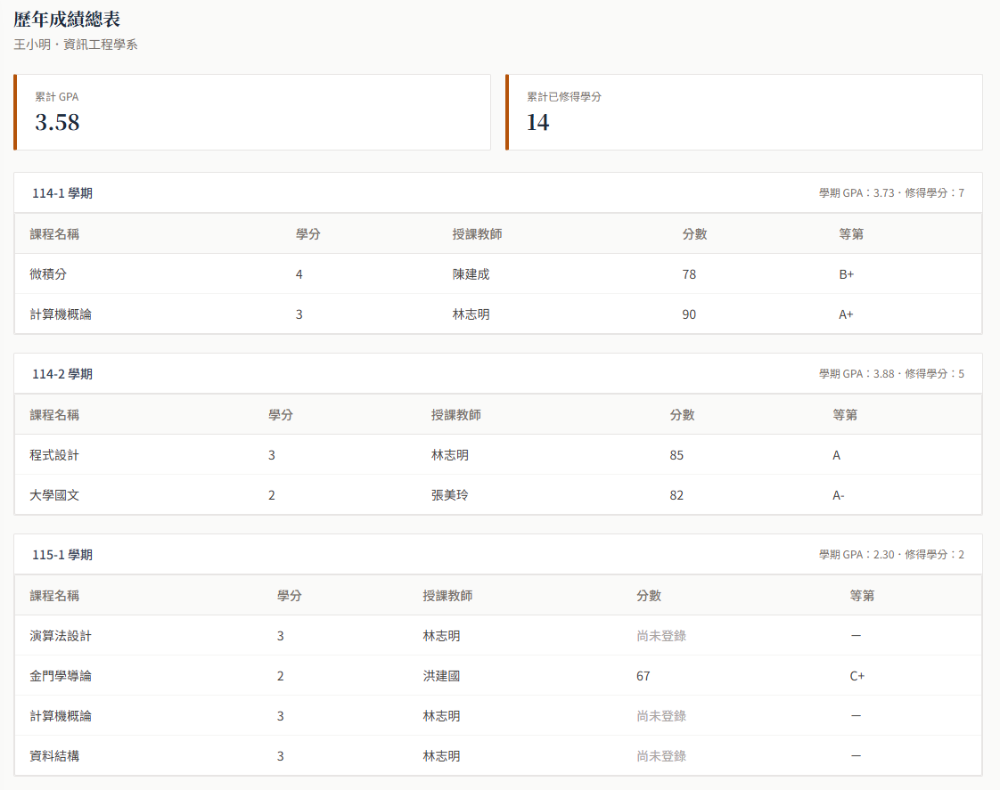

9. **課程管理**：管理者可新增、編輯、刪除課程

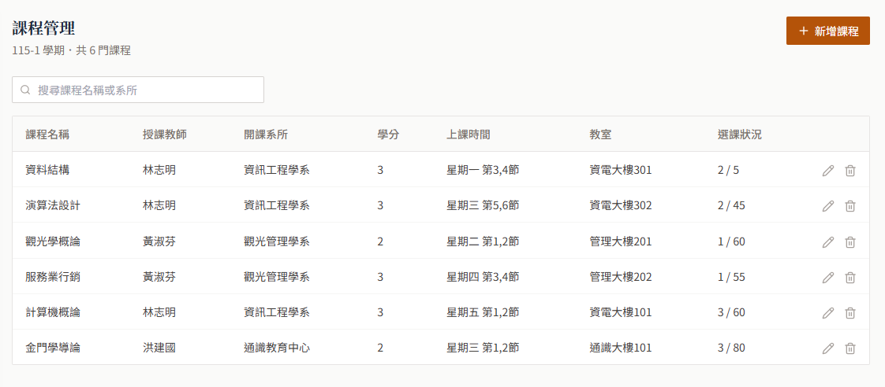

10. **新增課程表單彈窗**：表單支援節次多選與下拉選單

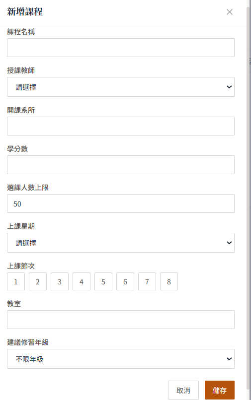

11. **教室衝堂錯誤提示**：儲存時自動偵測教室衝堂並提示

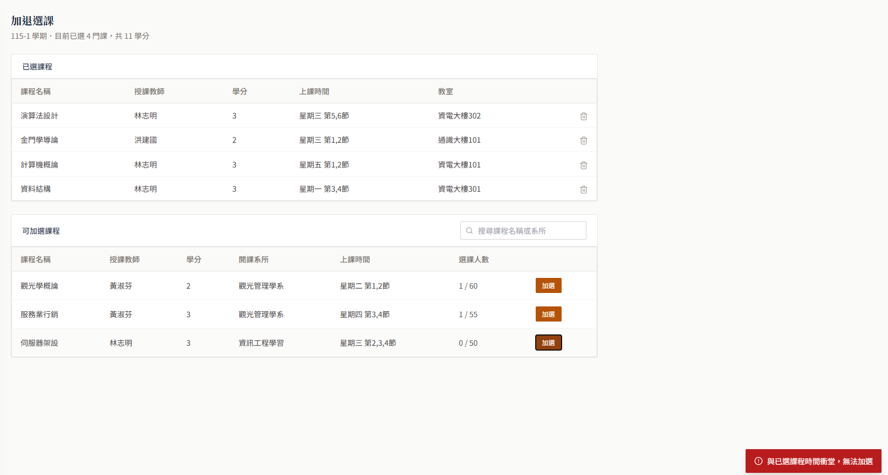

12. **確認刪除對話框**：危險操作皆有二次確認

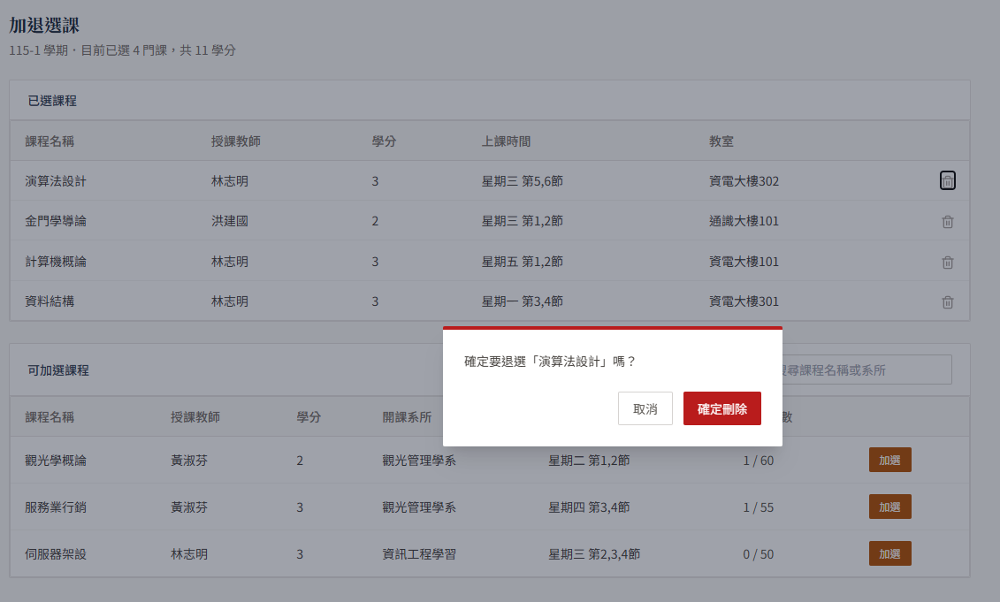

13. **修改密碼提示彈窗**：學生首次登入提醒修改密碼

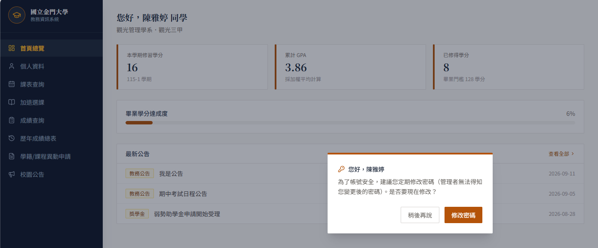

14. **校園公告頁**：公告依角色權限顯示發布 / 編輯按鈕

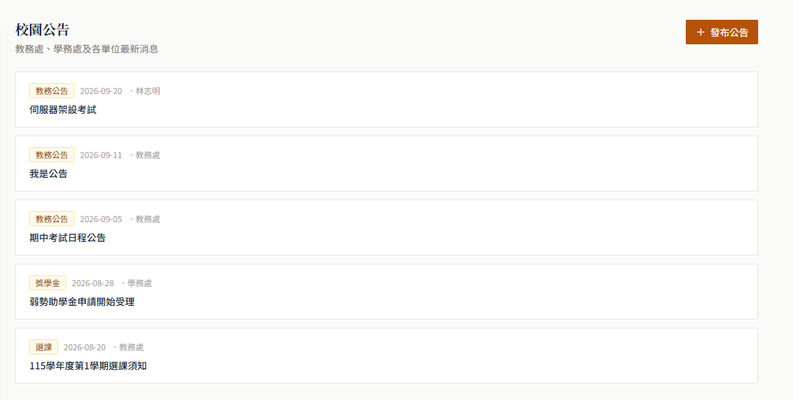
