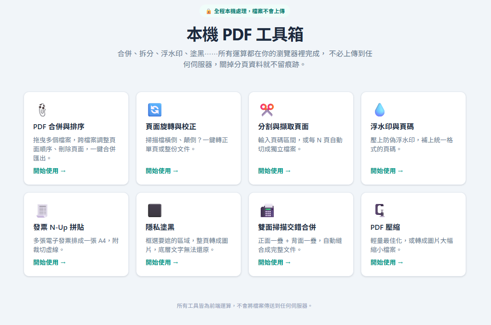
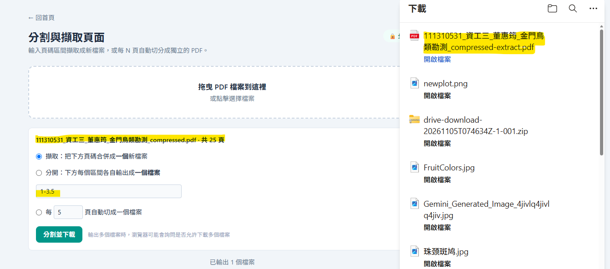
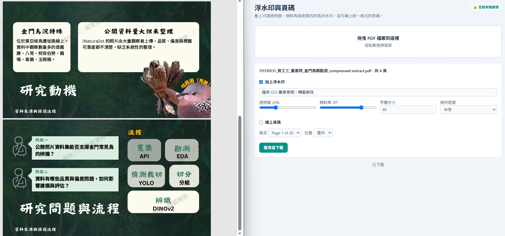
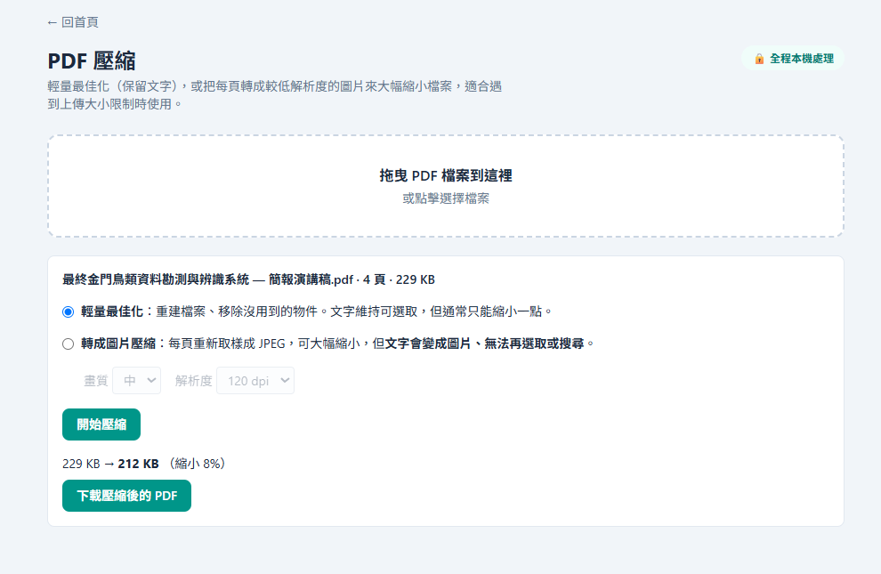
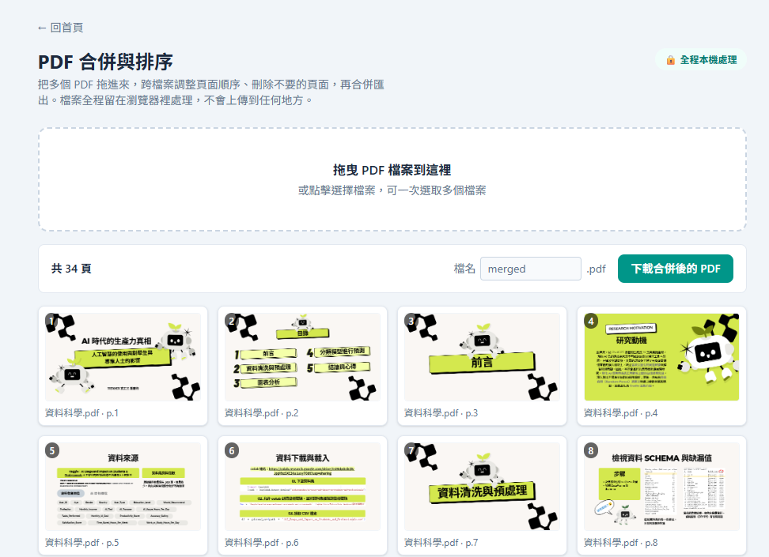
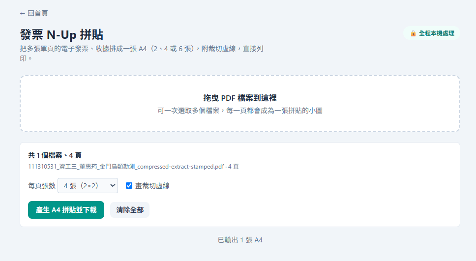
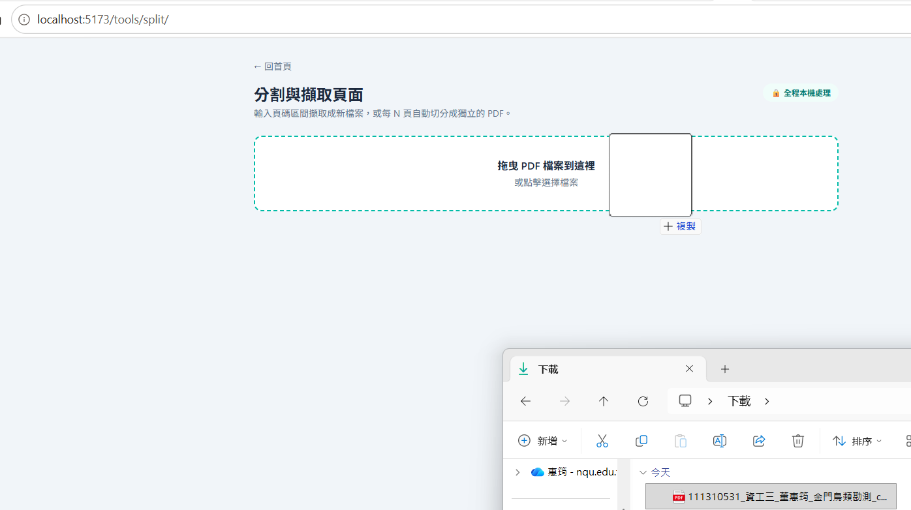

# 本機 PDF 工具箱（Local PDF Tool）

## 一、簡介

本機 PDF 工具箱提供合併、旋轉、分割、浮水印、N-up 排版、隱私塗黑、雙面交錯合併、壓縮等八種常見 PDF 操作。

所有運算皆在使用者的瀏覽器內完成，**檔案不會離開本機**，關掉分頁後不留痕跡。適合處理含敏感內容（如身分證、合約、發票）的 PDF 檔案，不必擔心上傳到第三方伺服器的隱私風險。

### 核心特色

- **隱私優先**：零上傳、零伺服器，所有處理都在瀏覽器記憶體中完成

- **八種實用工具**：合併、旋轉、分割、浮水印、N-up、塗黑、交錯合併、壓縮

- **多頁打包架構**：每個工具獨立入口，首頁以卡片方式導覽

- **現代建置流程**：Vite + Tailwind CSS v4，支援 HMR 開發

- **頁碼區間語法**：支援 `"1-3, 5, 8-10"` 這種直覺的頁面選擇方式


## 二、技術架構

### 技術棧

| 項目 | 使用技術 |
|------|----------|
| 建置工具 | Vite 8 |
| 樣式 | Tailwind CSS 4（`@tailwindcss/vite` 外掛） |
| PDF 建立 / 編輯 | `pdf-lib` 1.17 |
| PDF 解析 / 轉圖 | `pdfjs-dist` 6.3 |
| 語言 | 原生 JavaScript（ESM） |

> **不需要額外安裝任何套件**，所有依賴已列於 `package.json`。

### 檔案結構

```
local-pdf-tool/
├── index.html                    # 首頁（卡片由 src/home.js 產生）
├── vite.config.js                # 多頁打包設定（工具清單在 tools 陣列）
├── package.json
├── tools/                        # 每個工具一個入口 HTML
│   ├── merge/index.html
│   ├── rotate/index.html
│   ├── split/index.html
│   ├── watermark/index.html
│   ├── nup/index.html
│   ├── redact/index.html
│   ├── interleave/index.html
│   └── compress/index.html
└── src/
    ├── style.css                 # Tailwind v4（一行 @import）
    ├── common.js                 # 共用函式：上傳區、讀檔、渲染頁面、下載、版面外框
    ├── ranges.js                 # 頁碼區間解析（"1-3, 5, 8-10"）
    ├── home.js                   # 首頁卡片清單
    ├── merge.js                  # 合併
    ├── rotate.js                 # 旋轉
    ├── split.js                  # 分割與擷取
    ├── watermark.js              # 浮水印與頁碼
    ├── nup.js                    # 發票 N-Up 排版
    ├── redact.js                 # 隱私塗黑
    ├── interleave.js             # 雙面交錯合併
    └── compress.js               # PDF 壓縮
```

### 多頁打包機制

`vite.config.js` 中以 `tools` 陣列宣告所有工具資料夾，Vite 會自動把每個 `tools/<名稱>/index.html` 編譯成獨立入口：

```js

const tools = ['merge', 'rotate', 'split', 'watermark', 'nup', 'redact', 'interleave', 'compress'];

```

新增工具時，只需在陣列加一個名稱、建立對應資料夾與 `src/<名稱>.js`，並在 `src/home.js` 加一行卡片，無須修改打包邏輯。


## 三、運作方法

### 環境需求

- Node.js **22.13 以上**（`pdfjs-dist` 6.x 的要求）
- npm（隨 Node.js 附帶）
- 任一現代瀏覽器（Chrome / Edge / Firefox / Safari）

### 安裝與啟動

```bash
# 1. 安裝依賴
npm install

# 2. 啟動開發伺服器（含 HMR）
npm run dev
```

開啟終端機顯示的本機網址（通常是 `http://localhost:5173`）即可使用。

### 其他指令

```bash

npm run build      # 打包正式版到 dist/
npm run preview    # 預覽打包結果

```

### 使用流程

1. 在首頁點選任一工具卡片
2. 將 PDF 拖進上傳區（或點擊選擇檔案）
3. 依工具需求設定參數（頁碼區間、旋轉角度、浮水印文字等）
4. 點擊執行，處理完成後自動下載結果

---

## 四、工具說明

| 工具 | 功能 | 實作方式 | 已知限制 |
|------|------|----------|----------|
| **合併** | 將多份 PDF 依序合併為一份 | pdf-lib `copyPages` | 無 |
| **旋轉** | 旋轉整份或指定頁面 | pdf-lib 設定頁面 `rotation` | 無 |
| **分割與擷取** | 依頁碼區間取出指定頁面 | pdf-lib `copyPages`，保留文字與向量 | 無 |
| **浮水印與頁碼** | 加上浮水印文字或頁碼 | 浮水印用 canvas 畫成透明 PNG 平鋪（中文免字型檔）；頁碼用 Helvetica | 頁碼只支援英數格式；頁面本身若帶旋轉屬性，浮水印 / 頁碼方向可能與畫面不同 |
| **發票 N-Up** | 把多頁縮排到 A4 格子（如 2×2） | pdf.js 將每頁轉成約 144 dpi 圖片貼入格子，`drawLine` 畫虛線 | 輸出為圖片，文字不可選取 |
| **隱私塗黑** | 將敏感區域燒成純黑 | 整份文件轉成圖片後燒入黑色塊，輸出全新 PDF | 所有頁面變成圖片（這正是安全的原因）；檔案可能變大 |
| **雙面交錯合併** | 兩疊 PDF 逐頁交錯（可反轉第二疊） | 手動逐頁排列後合併 | 兩份頁數不同時，多的頁面接在最後 |
| **PDF 壓縮** | 縮小檔案體積 | 「輕量」重建文件移除未引用物件；「圖片」將頁面轉成 JPEG | 輕量模式效果有限；圖片模式文字不可選取，純文字 PDF 甚至可能變大（畫面會提醒） |


## 五、新增工具的流程

1. 複製 `tools/split/` 為 `tools/<新名稱>/`，將 HTML 中的 `/src/split.js` 改為 `/src/<新名稱>.js`

2. 撰寫 `src/<新名稱>.js`（參考 `split.js` 的流程：`mountShell` → 填 `panel.innerHTML` → `setupDropzone`）

3. 在 `vite.config.js` 的 `tools` 陣列加入名稱

4. 在 `src/home.js` 的 `tools` 陣列加入一行卡片資料

## 六、展示

1**首頁**：首頁以卡片方式導覽八個工具，並標示全程本機處理



2**分割與擷取**：支援 `"1-3, 5, 8-10"` 這種直覺的頁碼區間語法 |



3**隱私塗黑前後對照**：敏感區域燒成純黑，輸出為全新 PDF | 


4**浮水印效果**：浮水印以 canvas 繪製，中文不需額外字型檔 | 



5**PDF 壓縮**：顯示壓縮前後大小，並提醒圖片模式的限制



6. **合併工具**：支援多檔上傳並可調整合併順序



7. **N-Up 排版**：將多頁縮排到單張 A4，適合列印發票



8. **雙面交錯合併**：適合將單面掃描檔轉成雙面列印用


9. **拖放上傳區**：支援拖放上傳，提供即時視覺回饋



10. **處理中 Loading 狀態**：處理大檔時顯示進度，避免使用者以為當機